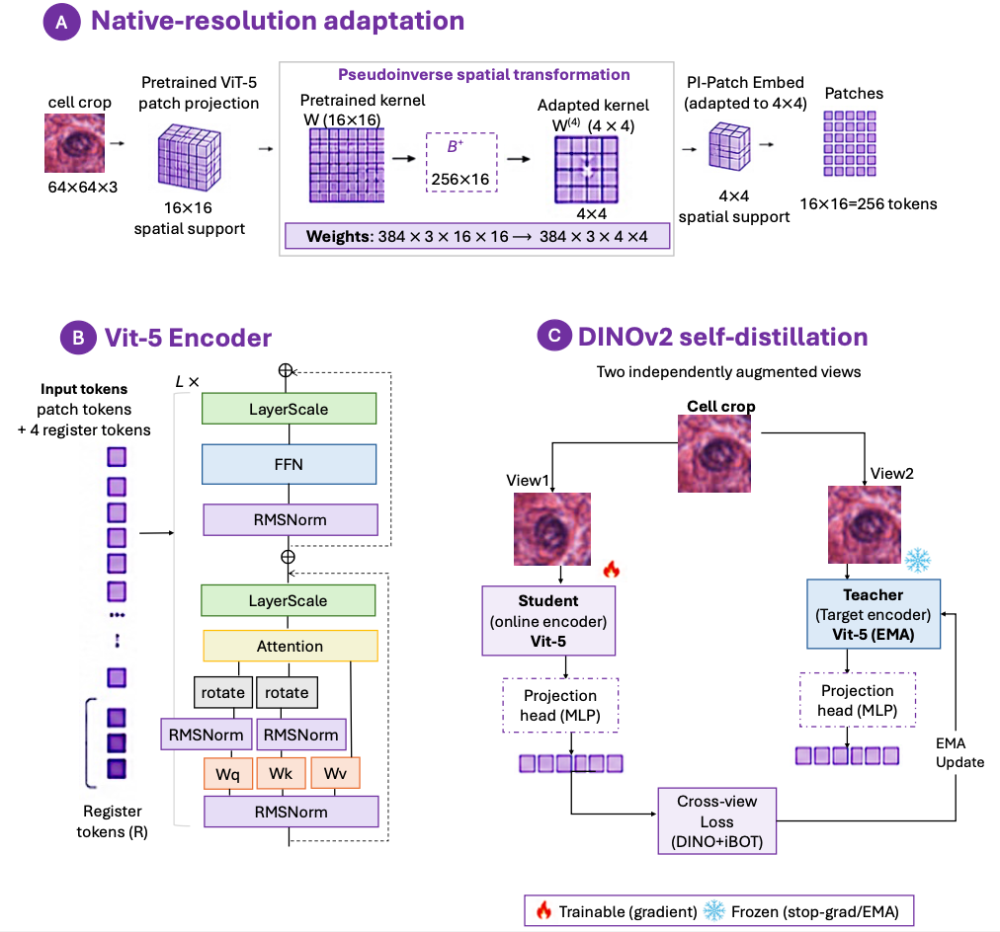

<p align="center">
  
</p>

<h1 align="center">C-LiTE: A Lightweight Foundation Model for Cellular Feature Learning in Histopathology</h1>

<p align="center">
  <a href="#citation">Paper</a> |
  <a href="https://huggingface.co/eshasadia/C-LiTE">Model weights</a> |
  <a href="https://www.ebi.ac.uk/biostudies/studies/S-BSST3558">Pre-training data</a> |
  <a href="https://github.com/tissueimageanalytics/tiatoolbox">TIAToolbox</a> |
  <a href="#citation">Cite</a>
</p>

<p align="center">
  <a href="https://colab.research.google.com/github/eshasadia/C-LiTE/blob/main/clite_cell_feature_learning.ipynb"></a>
  <a href="https://huggingface.co/eshasadia/C-LiTE"></a>
  <a href="https://www.ebi.ac.uk/biostudies/studies/S-BSST3558"></a>
</p>

<p align="center">
Esha Sadia Nasir, Jiaqi Lv, Gozde N. Gunesli, Shan E Ahmed Raza<br>
VISION Lab, Department of Computer Science, University of Warwick, UK
</p>

---

## Updates

- **11/2026:** Code, model weights and the 60M-cell pre-training corpus released.
- **11/2026:** Example notebook added to [TIAToolbox](https://github.com/tissueimageanalytics/tiatoolbox).

## What is C-LiTE?

C-LiTE learns representations of individual cells from H&E histology. Most pathology foundation models are trained on tissue patches containing hundreds of cells. The existing cell-level models are either limited to specific cell populations or have hundreds of millions of parameters.

C-LiTE is a **22M-parameter** self-supervised model built specifically for single cells:

- **Native-resolution input:** it processes **64 × 64 px cell-centred crops** with a **4 × 4 patch embedding**, giving 256 tokens with no upsampling.
- **PI-PatchEmbed:** pre-trained ViT-5-S weights are transferred from 16 × 16 to 4 × 4 patches using a Moore–Penrose pseudoinverse, so the patch projection doesn't have to be learned from scratch.
- **Large, balanced pre-training corpus:** **~60M cells** from TCGA, balanced across 19 cancer types and 16 tissue types. To our knowledge this is the largest public cell-level H&E dataset for self-supervised learning.
- **Efficient:** it comes within 0.012 average macro-F1 of CytoFormer (681M parameters), with **30× fewer parameters**, **16× fewer FLOPs** and **21× higher throughput**. It embeds **1M cells in about 16 minutes** on a single A100.

<p align="center">
  
</p>

*(A) PI-PatchEmbed adapts the pre-trained patch projection from 16 × 16 to 4 × 4. (B) The ViT-5 encoder with register tokens. (C) DINOv2-style teacher–student self-distillation (DINO + iBOT).*

## Model Variants

| Model | Initialisation | Feature dim | Params | Input |
|---|---|---|---|---|
| **C-LiTE** | ImageNet ViT-5-S | 384 | 22M | 64 × 64 px, 4 × 4 patch |
| **C-LiTE\*U** | Distilled from UNI2 | 384 | 22M | 64 × 64 px, 4 × 4 patch |
| **C-LiTE\*V** | Distilled from Virchow2 | 384 | 22M | 64 × 64 px, 4 × 4 patch |

**Which one should I use?** **C-LiTE** is the most robust default. **C-LiTE\*U** tends to do better on tasks with broad categories and severe class imbalance.

## Downstream Tasks

- Immune cell phenotyping
- Cell type classification
- Mitosis classification (normal vs atypical)
- Nucleus classification
- Hierarchical subtype classification

## Quick Start

The notebook is self-contained. The ViT-5 architecture is defined inline, so it needs no `timm`, `einops`, `flash-attn` or `xformers`. The data is downloaded directly from the Hugging Face Hub.

```bash
pip install torch torchvision datasets numpy pillow scikit-learn matplotlib tqdm
jupyter lab clite_cell_feature_learning.ipynb
```

Or open it directly in Google Colab with the badge at the top of this page.

### Input requirements

- RGB H&E crop of **64 × 64 px**, centred on a nucleus
- Pre-training resolution of **~0.5 µm/px (20×)**

### Using C-LiTE on your own slides

1. Extract a 64 × 64 px crop centred on each nucleus centroid.
2. Pass the crops through C-LiTE in batches and use the class-token embedding (384-d) for each cell.
3. Train a linear classifier, or cluster the embeddings for label-free phenotyping.

### Efficiency

Measured on a single NVIDIA A100:

| | C-LiTE | UNI2/Virchow2/CytoFormer | |
|---|---|---|---|
| Parameters | 22.5M | 681.6M | **30× smaller** |
| FLOPs / input | 11.1G | 180.4G | **16.2× fewer** |
| Throughput | 1,039 cells/s | 49 cells/s | **21.1× faster** |
| Peak GPU memory | 4.5 GB | 26.5 GB | **6.0× less** |

## Pre-training Data

The corpus contains ~60M cell-centred 64 × 64 px crops from TCGA whole-slide images. Nuclei were detected with HoVer-Net at 0.5 mpp, and the crops were sampled equally from 19 cancer types (3,157,895 cells each):

BRCA, LUAD, LUSC, OV, COAD, READ, CESC, KIRC, KIRP, PAAD, LIHC, PRAD, UCEC, UCS, THCA, STAD, HNSC, BLCA, ACC

- **Download:** [EMBL-EBI BioStudies S-BSST3558](https://www.ebi.ac.uk/biostudies/studies/S-BSST3558)
- **Source slides:** [NCI Imaging Data Commons](https://portal.imaging.datacommons.cancer.gov)

## Repository Structure

```
C-LiTE/
├── notebooks/clite_cell_feature_learning.ipynb   
├── assets/                             
└── ...                                
```

## Acknowledgements

C-LiTE builds on [DINOv2](https://github.com/facebookresearch/dinov2), ViT-5, [HoVer-Net](https://github.com/vqdang/hover_net) and [TIAToolbox](https://github.com/tissueimageanalytics/tiatoolbox). We thank the organisers of the MIDOG 2025, NuCLS, PanNuke, CoNIC, MONKEY, Immunocto and PUMA datasets.

## Citation

If you find C-LiTE useful, please cite:

```bibtex
@misc{nasir2026clitelightweightfoundationmodel,
      title={C-LiTE: A Lightweight Foundation Model for Cellular feature learning in Histopathology}, 
      author={Esha Sadia Nasir and Jiaqi Lv and Gozde N. Gunesli and Shan E Ahmed Raza},
      year={2026},
      eprint={2611.26316},
      archivePrefix={arXiv},
      primaryClass={cs.CV},
      url={https://arxiv.org/abs/2611.26316}, 
}
```

## Contact

For questions or issues, please open a [GitHub issue](https://github.com/eshasadia/C-LiTE/issues) or email esha.nasir@warwick.ac.uk.
