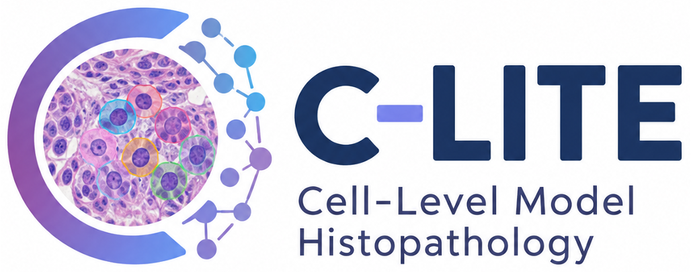

#  C-LITE — A Cell-Level Representation Learning Model

Downstream Tasks:
- Cell Phenotyping
- Cell Type Classification
- Mitosis Classification
- Nucleus Classification
- Hierarchical Subtype Classification

Feature Extraction

PCA Visualization

TSNE/UMAP PLOTs

  
